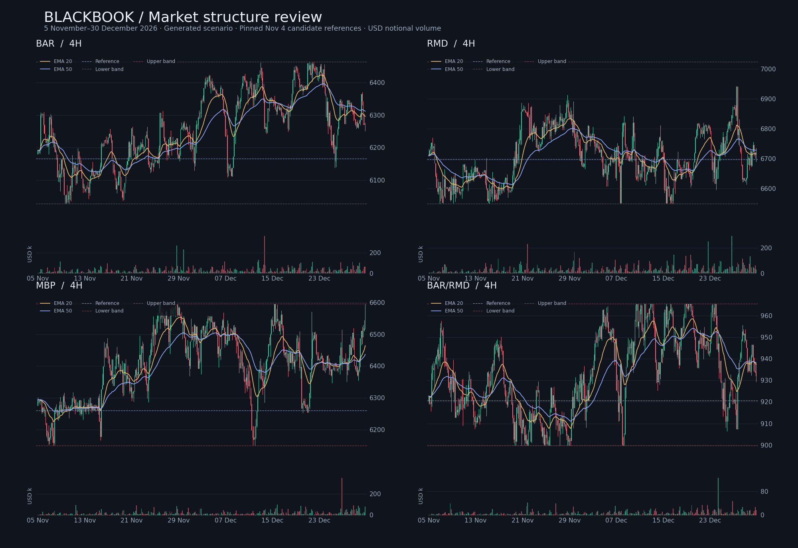

# Market structure scenario: November 5–December 30, 2026

Superseded by [the continuous November 6 release](../2026-11-06/README.md).
This original scenario independently initialized prices at November 5 and can
introduce a price discontinuity when appended to the earlier archive.

38 import-ready CSVs under `admin/`, with 1,344 hourly candles per market
(51,072 total). Coverage starts at midnight **November 5 in Africa/Lagos**,
`2026-11-04T23:00:00Z`, and ends at midnight December 31 in that timezone,
exclusive cutoff `2026-12-30T23:00:00Z`. Earlier archives remain intact.



## Starting references and sporting context

The 30 constituent references and bands are pinned to the reviewed **November 4
candidate in [PR #12](https://github.com/therealsylva/index-price/pull/12)**,
commit `e4aea27784c6003e3cc546981bc0cc4b56a646c7`. That PR is unmerged at
generation time; these are candidate inputs, not a production publication.
`inputs/basis.json` retains the exact selected rows, source shard Git hashes,
and the source status. No canonical index pointer or publication is modified.

The candidate covers completed matches through November 3. The recent match
audit from that commit and the existing November 1 context supply up to five
recent completed team results per instrument, including available UEFA matches.
These results gently bias opening sentiment; the effect decays over 36 hours.
Athlete sentiment uses their team's results, without inventing personal goals,
ratings, appearances or injury information. Recent audit results become
available conservatively at the candidate publication time. November 4 results
are not asserted or silently treated as draws.

Available fixture schedules come from the November 1 archived capture and
extend through November 21 for some teams. They affect activity only. Missing
later fixtures do not imply those teams have no matches. No future score,
player statistic, reference move, or live-band transition is fabricated.

## Price behaviour

`tools/market_structure_scenario.py` replaces long-duration target steering
with five-minute stochastic paths. Hourly OHLC values come from those samples:

- Local ranges, compression, trends and expansion last variable amounts of time.
- Trends contain short countertrend pressure; compression can release into expansion.
- Heavy-tailed innovations, clustered variance and occasional pressure shocks
  create uneven bursts, retracements and recoveries.
- Each instrument has a distinct activity profile. Shared team and market
  factors give related instruments partial correlation.
- Liquidity resistance near a hard band and reflected overshoots produce
  rejections without repeatedly pinning price to an identical boundary.
- All eight pair prices use simultaneous constituent ratios at every sample,
  with inherited asymmetric bands. `MUN/MCI` is supplied directly for the live
  catalog; there is no duplicate inverse market.

This is a generated chart scenario, not actual executions or a validated
statistical fit to a traded exchange. Technical patterns emerge from simulated
pressure and volatility; neither profitable signals nor named chart formations
are guaranteed. The opening market prices are simulated, not live quotes.

## Volume and importer use

The original twelve-column importer schema is preserved, including `volumeUsd`.
Volume represents single-counted USD notional across all 38 instruments,
weighted by session, available fixtures, candle activity, market popularity,
persistence and irregular bursts. Weekly totals follow the existing uneven
growth schedule into the requested $10–50m final weekly range. Exact totals
and partial-week coverage are in `weekly-volume.csv`.

References and bands remain frozen to the pinned candidate for the scenario.
The source band horizon is November 7; continuation beyond that is a scenario
assumption, not a claim that those bands remain valid in production. Before
importing against a newer sporting publication, regenerate or reconcile those
constraints. Existing importer completion-time visibility must be retained.
Do not use these future rows as historical trading evidence or live trade volume.

This PR supplies files for review; it does not import, deploy or merge anything.

## Reproduce and validate

The generator needs Python 3.11+ and the standard library. From repository root:

```sh
python3 tools/market_structure_scenario.py
python3 -m unittest discover -s tests -p 'test_market_structure_scenario.py'
npm test
```

The input capture and PR commit are fixed, so replay produces identical CSVs,
diagnostics and manifest. The manifest commits every input, CSV, diagnostic
report and weekly-volume file by SHA-256. The optional review sheet uses
matplotlib: `python3 tools/plot_market_structure.py`.

`diagnostics.json` records every market's candle distribution. Across the 38
markets the median typical absolute hourly move is about 0.127%, median
consecutive-return correlation is about -0.006, median absolute-return
correlation is 0.181, and about 9.2% of candles have no wicks. Broad regression
checks guard against reintroducing excessive price smoothing.
