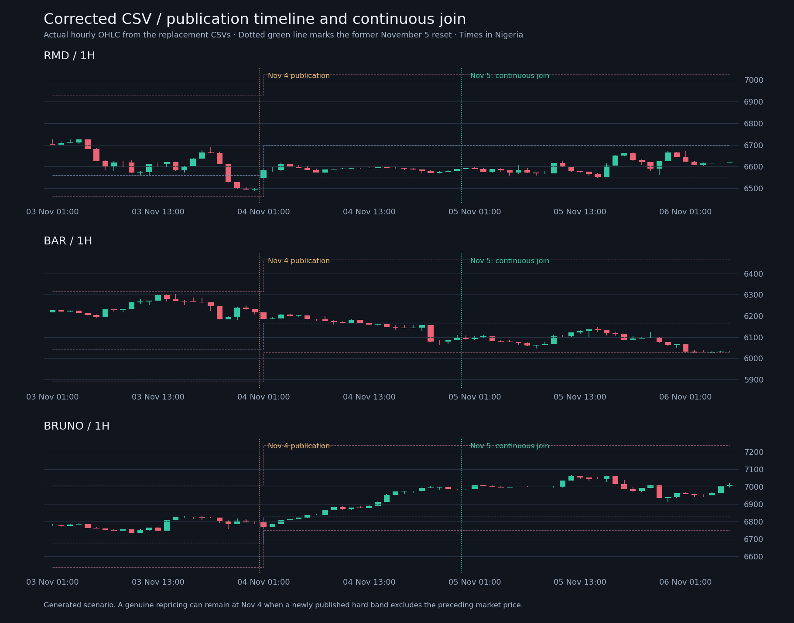

# Continuous extension using the merged November 4 bands

This release supersedes the November 5 scenario that independently initialized
market prices and caused a price discontinuity across all 38 instruments.
It contains 38 twelve-column CSVs, 1,431 candles per instrument (54,378 total),
ending at `2026-12-30T23:00:00Z`: the end of December 30 in Africa/Lagos.



The replacement begins at **November 1, 08:30 UTC / 09:30 Nigeria time**.
That is the last verified archive close. Replacing the forward scenario from
that checkpoint allows the corrected November 4 publication to take effect
chronologically before November 5. It preserves the archive before the join.
Import the entire replacement range, rather than extracting only November 5.

## Reference and market-price continuity

- Initial prices, references and bands come from the checksum-bound final rows
  of `market-history/2026-11-01`, not newly generated opening prices.
- All 30 base instruments open at exactly the preceding archive close. Seven
  direct pairs also match exactly. MUN/MCI differs by one micro-unit because
  the older inverse alias rounds twice and the new direct ratio floors once.
- The initial November 1 publication remains effective through the bar ending
  November 4, 00:00 UTC. The newly merged November 4 publication applies to the
  next bar and all subsequent scenario rows.
- Source commit: `42489466d5afd439b61d563c7945e51370dc03db`, merging the corrected
  league/UEFA update in PR #12. Its sporting coverage ends November 3; this
  release does not claim November 4–5 matches have been processed.
- November 5 is an ordinary hourly boundary. No price or reference reset occurs
  there. Every timestamp and price joins continuously outside the actual
  publication transition.
- At a publication, retain the existing price whenever the complete set of
  base/pair constraints permits it. Otherwise constrain it to the allowed band
  and record the resulting repricing in `manifest.constraintTransitions`.
  Never reset all prices to their new sporting reference.

Some legitimate price gaps remain when the new published constraints exclude
the previous price. The checked release records 17 affected base/pair markets
at the November 4 publication. These are explicitly audited; removing them
would require violating a hard band or retroactively steering prices with
future information. Earlier archive gaps created by the older model's sporting
reference resets are outside this replacement and are not silently rewritten.

## Model and source integrity

`tools/continuous_market_scenario.py` retains the v2 five-minute stochastic
mechanics and seed family: changing volatility, ranges, compression/expansion,
trend pullbacks, heavy-tailed innovations, shared factors and intrahour wicks.
Pairs are computed from simultaneous constituents at every sample. Sentiment
uses only team results available by that sample, including the conservative
November 4 availability assigned to the newly audited results. Individual
athlete performances are not invented.

`inputs/basis.json` binds both publication snapshots and their source hashes.
`inputs/continuity.json` binds the original archive manifest, each original CSV
and each final row. Generation verifies those files and rows before using the
checkpoint; tampering or an incompatible starting band is rejected.

Known schedules remain from the archived November 1 capture, not a fresh
fixture feed. References after November 4 remain frozen scenario assumptions,
including beyond their original band horizon. Regenerate or reconcile when a
later sporting publication becomes available. Generated prices and USD notional
volume are chart scenarios, not actual executions, deposits or revenue.

## Native server import

Use the deployed native backend's `deploy/native/run.mjs` launcher with
`apps/api/src/synthetic-history-import-main.js DIRECTORY --service --publish --replace`.
It uses local PostgreSQL through `DATABASE_URL`. No Supabase data key is needed.
All 38 markets are previewed before writes; replacement is atomic per market.
Future candles remain hidden until their completion time.

The native official index/active market-band publication must also be brought
to the corrected November 4 values using its normal publication lifecycle.
A Git merge or candle import alone does not publish live trading bands. Do not
reset trading state or overwrite the active-market registry to force agreement.
This PR supplies the corrected CSVs and does not deploy anything.

## Reproduce

```sh
python3 tools/continuous_market_scenario.py
python3 -m unittest discover -s tests -p 'test_continuous_market_scenario.py'
npm test
```

Validation checks every archive join, every new hourly join, both sides of the
publication timeline, base/pair OHLC/bounds, exact pair ratios, source/output
checksums, exact weekly volume totals, replay determinism, and future result
availability. The first candle lasts 30 minutes; later candles last one hour.
